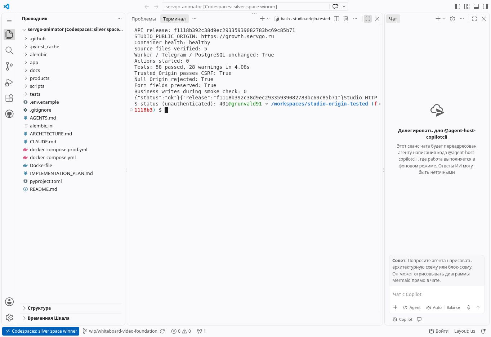

# Проверка Studio Origin и обработка ошибки

Развёрнут код: `f1118b392c38d9ec29335939082783bc69c85b71`.

Значение `STUDIO_PUBLIC_ORIGIN` в работающем API до и после обновления:
`https://growth.servgo.ru`. Менять его не потребовалось.

Причина прежнего пользовательского `403 Cross-origin action rejected` пока не установлена.
В старом журнале подтверждён POST на
`/studio/products/04392041-ea09-4853-874e-8060bee7286c/create` со статусом 403,
но заголовок Origin в этом журнале отсутствует. Не могу подтвердить его значение.
Проверки с Origin=null ниже являются контролируемыми тестами, а не восстановленным пользовательским запросом.

## Изменения

- При отказе форма показывает понятное сообщение и код ошибки.
- JavaScript отправляет форму без перехода на JSON-страницу; поля остаются в браузере при ошибке.
- При обычной HTML-отправке сервер возвращает страницу ошибки с полями формы создания материала.
- После отказа доступна повторная отправка. Автоматической повторной отправки нет.
- Выбранная площадка сохраняется при восстановлении формы; поле площадки скрыто для полного пакета.
- Отказ записывается как `studio_origin_rejected`: код, причина, путь, настроенный Origin,
  фактический Origin, только origin из Referer и Sec-Fetch-Site.
  Содержимое формы, пароли и параметры Referer в диагностический лог не включаются.
- Проверка Origin остаётся обязательной. Origin=null не разрешён и не заменяется Referer.

Исходники: [коммит](https://github.com/grunvald91/Ai_growth_os/commit/f1118b392c38d9ec29335939082783bc69c85b71).

## Проверки

Команда в Codespace на указанной ревизии:

```sh
python -m pytest -q tests/test_content_studio*.py tests/test_studio_origin_errors.py
git diff --check 05cddb8fd433 HEAD
```

Результат: `58 passed, 28 warnings in 4.08s`.
Предупреждения в журнале относятся к устаревающим API зависимостей.

Проверка интерфейса на тестовом HTTP-стенде с реальными шаблоном, CSS и JavaScript:
полный пакет, заполненные тема и аудитория, пустые дополнительные требования;
первый ответ 403 сохранил все поля и показал сообщение, повторный ответ 303 открыл страницу задания.
Страница ошибки с восстановленными полями также проверена визуально.

Изолированный TestClient внутри обновлённого production-контейнера:
авторизация и БД подменены только в этом проверочном процессе;
производственные операции и платная генерация не выполнялись.

```json
{"release":"f1118b392c38d9ec29335939082783bc69c85b71","trusted_origin_passes_csrf":true,"null_origin_rejected":true,"form_fields_preserved":true,"structured_error_and_updated_js":true,"business_writes":0}
```

## Подтверждение выкладки

Пересоздан API. Docker health: `healthy`.
SHA-256 пяти изменённых файлов внутри контейнера совпали с файлами релиза:
`content_studio.py`, `content_studio_auth.py`, `content_studio_refresh.py`,
`content_studio_errors.py`, `app/main.py`.

Проверки с сервера:

```sh
docker exec ai-growth-os-api-1 printenv STUDIO_PUBLIC_ORIGIN
curl -fsS http://127.0.0.1:8091/health
curl -fsS http://127.0.0.1:8091/health/version
curl -sS -o /dev/null -w "%{http_code}" https://growth.servgo.ru/studio
```

Результаты:

```text
https://growth.servgo.ru
{"status":"ok"}
{"release":"f1118b392c38d9ec29335939082783bc69c85b71"}
401
```

401 — ожидаемый ответ защищённой страницы без авторизации.
Публичные /health и /health/version возвращают 404 по текущей конфигурации Nginx;
проверка API health выполнялась на внутреннем адресе.

Идентификаторы контейнеров worker, Telegram и PostgreSQL после обновления не изменились.
GitHub Actions вручную не запускались; ветка исправления не подходит под push-триггеры CI и деплоя, PR не создавался.
Телеметрия расхода минут не запрашивалась.

Резервная копия:
`/opt/ai_growth_os/backups/studio-origin-before-f1118b392c38`.
Сохранены предыдущий образ, конфигурация API и прежний путь current.
Откат в этой успешной выкладке не выполнялся.

Конфигурация запущенного API:
`/opt/ai_growth_os/releases/f1118b392c38d9ec29335939082783bc69c85b71/compose.origin.json`.
Файл содержит существующие настройки окружения, права 0600; в GitHub не выгружался.



Перед следующей пользовательской попыткой следует обновить страницу.
Если отказ повторится, его Origin и код ошибки будут доступны в новом диагностическом журнале.
